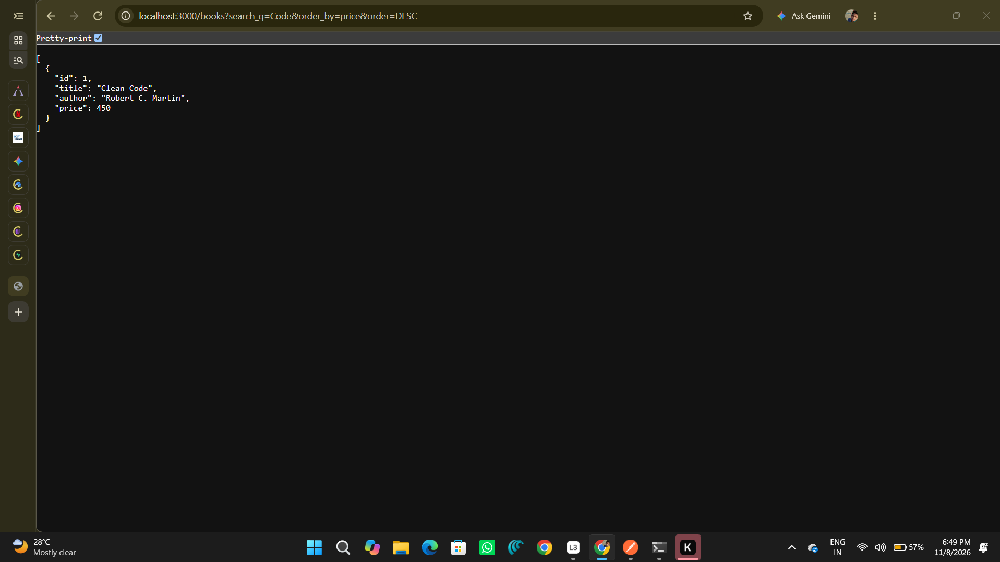
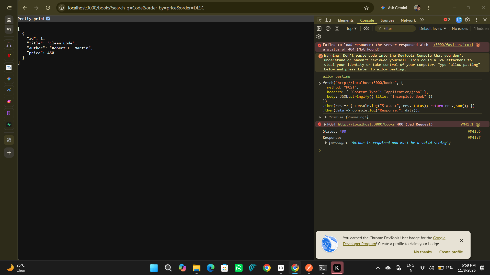
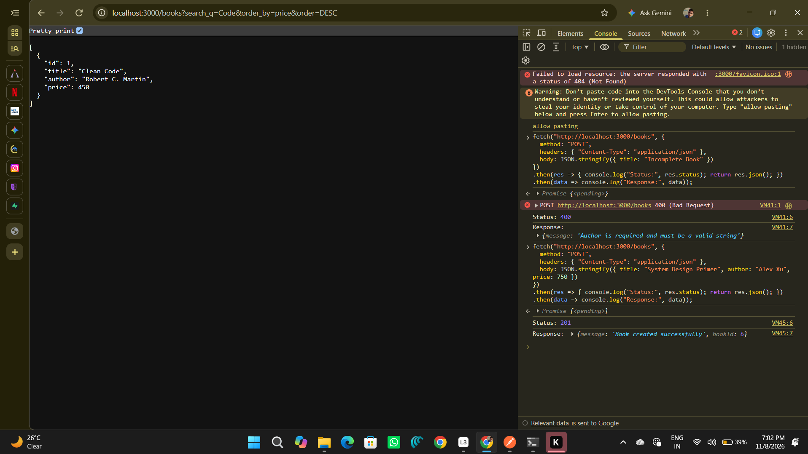
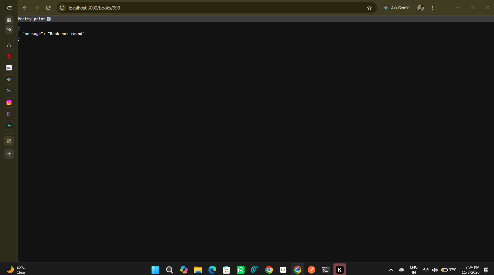

# Lab 3: REST API, query parameters, validation, debugging

**Name:** Yegireddy Dinesh  
**Registration Number:** 252U1R1265  
**Section:** Backend Development Fundamentals (Term II)  
**Live Link:** Not applicable (Local SQLite REST API Service)

---

## How to Run

### 1. Install Dependencies
npm install

### 2. Environment Variables
Create a .env file in the root directory:
PORT=3000

### 3. Start Command
npm run dev

---

## Endpoints

| Method | Path | Description |
| :--- | :--- | :--- |
| GET | /books | Retrieve books with optional search, sorting, limit/offset, and price range |
| GET | /books/:id | Retrieve single book details by ID |
| POST | /books | Create a new book with input validation (title, author, price) |
| PUT | /books/:id | Update an existing book's details |
| DELETE | /books/:id | Delete a book by ID |

---

## Screenshots

### 1. GET /books with search and sort

### 2. POST /books - Validation Failure (400)

### 3. POST /books - Success (201)

### 4. GET /books/:id - Not Found (404)

---

## Notes: Problems Faced and Solutions

1. **Node.js v24 SQLite Binding Incompatibility**: Resolved native build issues by integrating a pure WebAssembly SQLite driver (sql.js).
2. **Port Conflict (EADDRINUSE)**: Configured environment fallback ports via .env.
3. **Consistent Validation**: Enforced request body validation on POST to reject missing fields with 400 Bad Request.
